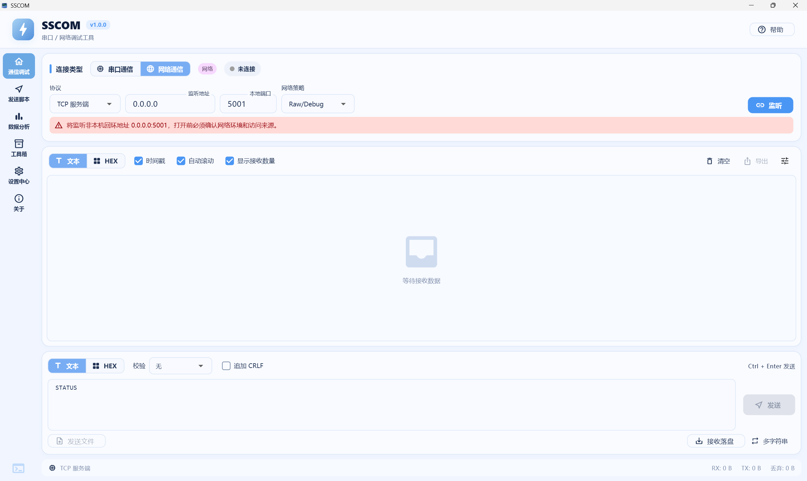

# SSCOM Flutter

面向 Windows 10/11 x64 的串口与网络调试工具，基于 Flutter 开发，提供文本与 HEX 收发、文件传输、多字符串发送、波形查看和实验性 ISP 功能。



## 功能概览

| 模块 | 功能 |
| --- | --- |
| 串口通信 | 串口参数配置、DTR/RTS 控制、文本与 HEX 收发、时间戳、虚拟化终端 |
| 发送与记录 | 七种校验追加、文件分块发送、多字符串循环发送、接收数据落盘 |
| 网络调试 | TCP 客户端、TCP 服务端、UDP，共用终端显示 |
| 波形查看 | 降采样显示、暂停与清空 |
| 配置管理 | JSON 设置持久化、旧版 INI 自动迁移、手动迁移预览与备份 |
| 诊断反馈 | 查看构建与运行信息，复制或导出脱敏报告，不自动上传 |
| ISP | STM32/GD32 AN3155 协议与 STM32 bootloader 模拟器；真实硬件功能仍处于实验阶段 |

## 快速使用

### 启动程序

使用已构建的 Windows x64 便携包时，解压完整目录后运行 `flutter_sscom.exe`，保留同目录的 DLL 和 `data/`。目标电脑需要 Microsoft Visual C++ x64 运行库。

从源码启动的方法见[源码开发](#源码开发)。程序默认使用真实串口，连接和发送均由用户手动触发。

### 串口收发

1. 将设备连接电脑，刷新端口列表并选择对应串口；端口号以本机枚举结果为准。
2. 按设备要求设置波特率、数据位、校验位、停止位、流控及 DTR/RTS。
3. 点击“连接”，选择文本或 HEX 模式，输入数据后点击“发送”，在终端查看响应。
4. 使用完毕后点击“关闭”；需要修改串口参数时，先关闭连接。

以支持 AT 命令的 ESP-07 为例，使用模块实际串口参数连接并关闭校验追加后，可验证以下两种等价输入：

| 发送模式 | 输入内容 | 换行设置 |
| --- | --- | --- |
| 文本 | `AT` | 勾选“追加 CRLF” |
| HEX | `41 54 0D 0A` | 已包含 CRLF，HEX 模式不自动追加 |

设备正常响应时，终端应显示 `OK`。

## 源码开发

### 开发环境

| 项目 | 要求 |
| --- | --- |
| 操作系统 | Windows 10/11 x64 |
| Flutter | 3.47.9 stable，配套 Dart 3.13.7 |
| 原生构建工具 | Windows C++ 构建工具链，可通过 `flutter doctor -v` 检查 |

项目使用 Signals 管理状态、GetIt 注入依赖、go_router 管理路由，真实串口通过 `flutter_libserialport` 接入。

### 启动开发版本

在项目根目录执行：

```powershell
flutter pub get
flutter run -d windows
```

无硬件演示时，使用内置回环模拟串口：

```powershell
flutter run -d windows --dart-define=SSCOM_SERIAL_BACKEND=simulated
```

`SSCOM_SERIAL_BACKEND` 是编译期参数，支持 `libserialport` 和 `simulated`，默认值为 `libserialport`。

### 验证与本地编译

安装依赖后执行：

```powershell
flutter analyze --no-pub lib test
flutter test --no-pub
flutter build windows --release --no-pub
```

本地编译产物位于 `build/windows/x64/runner/Release/`，运行时需保留完整目录。

### 代码结构

| 目录 | 职责 |
| --- | --- |
| [`lib/app/`](lib/app/) | 应用启动、依赖组装、路由、主题和主工作区 |
| [`lib/core/`](lib/core/) | 传输接口、缓冲、协议编解码与 ISP 协议核心 |
| [`lib/features/`](lib/features/) | 串口与网络、终端、文件传输、配置等功能模块 |
| [`test/`](test/) | 单元测试、Widget 测试、模拟传输与测试夹具 |
| [`windows/`](windows/) | Windows 原生入口与构建配置 |

## 配置与迁移

| 内容 | 默认位置 |
| --- | --- |
| 应用设置 | `%APPDATA%\SSCOM\settings.json` |
| 旧配置备份 | `%APPDATA%\SSCOM\migration-backup\` |

首次启动且没有新版设置时，程序会在当前工作目录和可执行文件目录查找 `sscom51.ini`，先备份原始文件，再保存迁移后的 JSON 设置。

手动迁移时，先断开串口或网络连接、停止多字符串发送并结束 ISP 会话，再进入“设置中心”选择旧 INI。检查迁移预览和警告，点击“备份并保存迁移设置”，重启应用后生效。

迁移不会修改或删除原始 `sscom51.ini`。

## 已知限制

- 真实串口验收已覆盖 CH340 + ESP-07，在 115200、8N1、无流控、DTR/RTS 关闭时完成 AT 文本与 HEX 收发、关闭重连验证；其他硬件组合、网络和 ISP 仍需真实环境验收。
- STM32/GD32 ISP 为实验性功能；STC/IAP15 烧录尚未启用，仍需完整设备通信记录和型号验证。
- 当前 Windows 构建未签名，应用图标仍为工程默认资源；尚未提供 Beta 反馈渠道。
